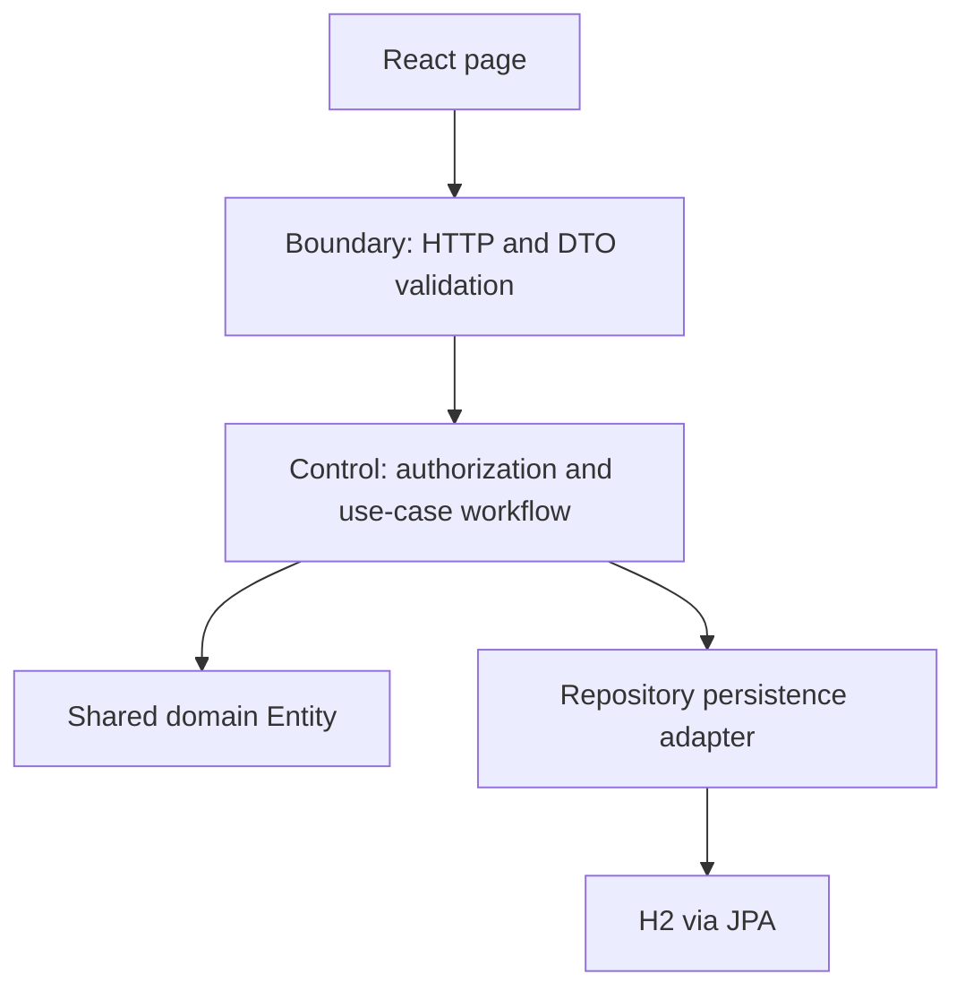

# Architecture and BCE mapping

The uploaded starter's package `edu.uow.csit314.idp` and layering are retained. React components do not bypass the API or access H2 directly.

| Area | React UI | Boundary | Control | Shared entities |
|---|---|---|---|---|
| Login/session | AuthPages, App | AuthenticationPage | AuthenticationController | UserAccount, UserProfile |
| Profile/account admin | UserManagementPage | UserManagementPage | UserManagementController | UserProfile, UserAccount |
| Signup approval | SignupPage, AccessRequestsPage | RegistrationPage | RegistrationController | RegistrationRequest, UserProfile, UserAccount |
| Company | CompanyPage | CompanyManagementPage | CompanyManagementController | Company, UserAccount |
| IDPs | ProjectsPage, DiscoverPage | IDPManagementPage | IDPManagementController | IDP, Company, IDPCategory |
| Shortlists/views | DiscoverPage, ProjectDetail | CustomerProjectsPage | CustomerProjectsController | Favourite, ProjectViewEvent, IDP |
| Category reads (original slice) | CategoriesPage; original component retained | ViewIDPCategoryPage | ViewIDPCategoryController | IDPCategory |
| Category writes | CategoriesPage | CategoryManagementPage | CategoryManagementController | IDPCategory, IDP |
| Reporting | ReportsPage | PlatformReportsPage | PlatformReportsController | ActivityEvent; derived ReportResponse |

A Control class groups related use-case methods; each story maps to explicit methods rather than a single generic JSON mutation handler. Domain entities include rules such as UserAccount activity/role checks, IDP stage transitions, and pending-registration review transitions. Repositories provide persistence, while DTOs prevent returning JPA entities or password hashes.

Authentication uses ordinary Spring/Tomcat HTTP sessions, not ChatGPT headers. Mutations require a session-bound CSRF token. Controls check active role and ownership on every protected operation. Account credential versions invalidate old sessions after suspension, restoration, password changes or role changes. An account can be active while its personal profile is separately suspended or removed.

The original category read API and its five tests are preserved. This group's final story list calls category viewing **#40**, not the earlier starter document's #42. Update your actual UML to these class/method names before submission; no claim is made that unseen UML already matches.
